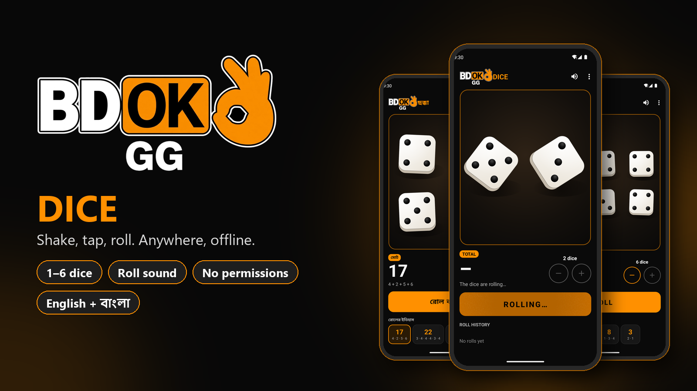
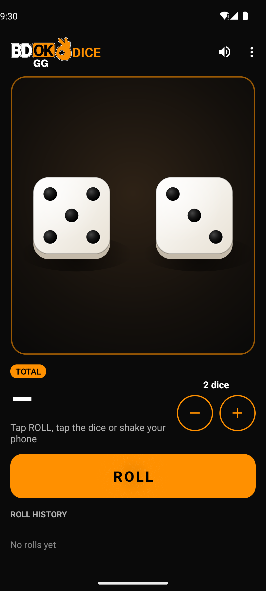
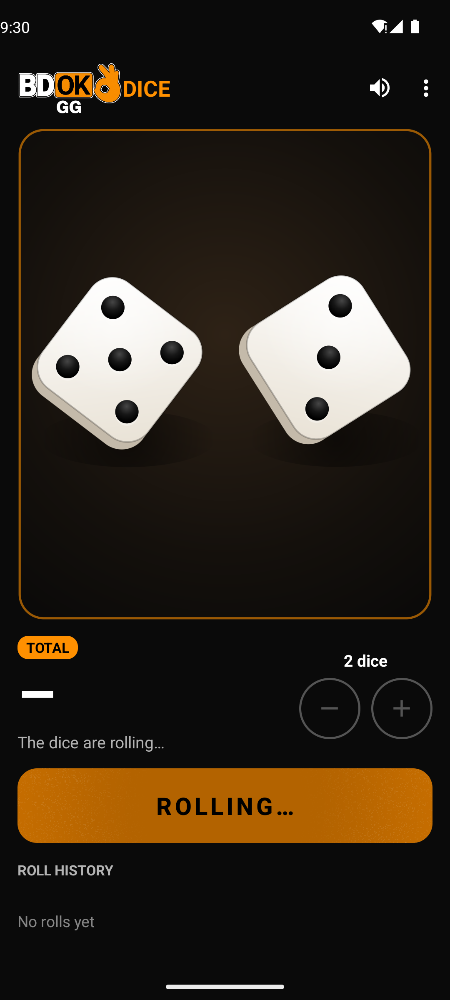
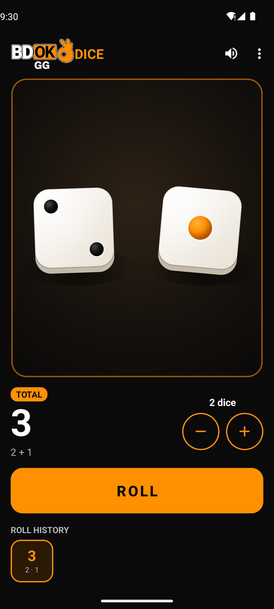
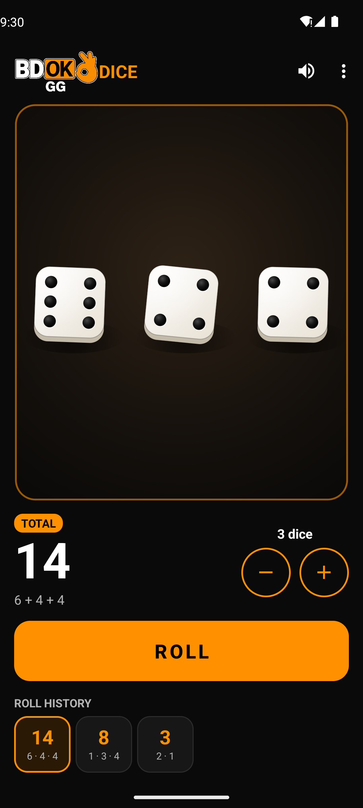
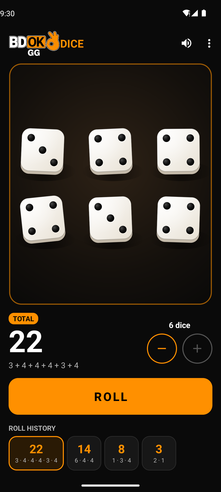
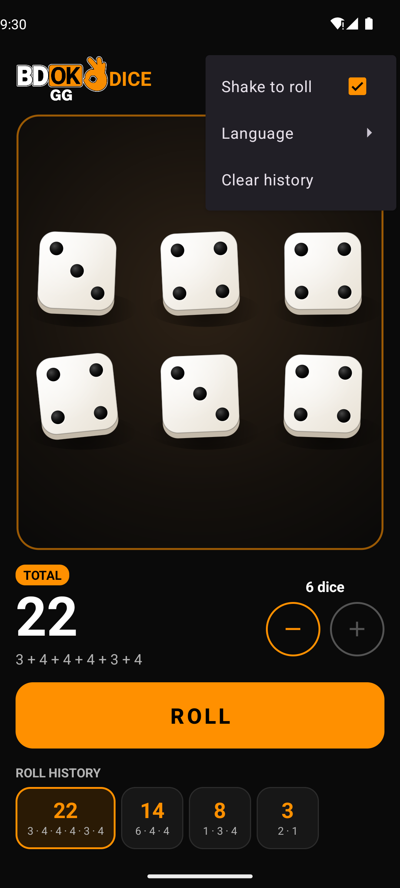
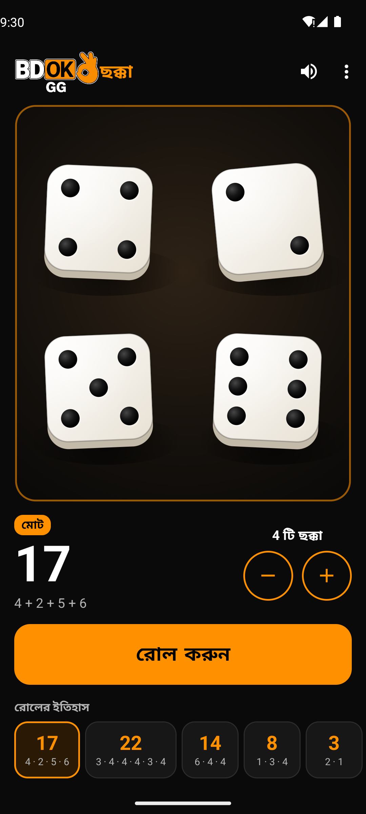

<p align="center">
  
</p>

<h1 align="center">BDOKGG Dice</h1>

<p align="center">
  <b>Shake, tap, roll. Anywhere, offline.</b><br>
  A lively dice roller for Android with tumbling 3D-style dice and a real roll sound, in <b>English</b> and <b>বাংলা</b>.
</p>

<p align="center">
  
  
  
  
</p>

---

## Screenshots

<table>
  <tr>
    <td align="center"><br><sub>Home</sub></td>
    <td align="center"><br><sub>Dice tumbling mid-roll</sub></td>
    <td align="center"><br><sub>Result and total</sub></td>
  </tr>
  <tr>
    <td align="center"><br><sub>Three dice, roll history</sub></td>
    <td align="center"><br><sub>Up to six dice</sub></td>
    <td align="center"><br><sub>Shake to roll, language, clear history</sub></td>
  </tr>
  <tr>
    <td align="center"><br><sub>বাংলা</sub></td>
    <td></td>
    <td></td>
  </tr>
</table>

## Features

- 🎲 **Lively dice:** custom-drawn dice that spin, bounce three times and settle, with shadows that shrink as they jump. The one-pip face is BDOKGG orange.
- 🔊 **Roll sound:** a clatter of dice on a table, with three variations and a slight random pitch so no two rolls sound the same. Turn it off with the speaker button.
- 📳 **Haptics:** light ticks while the dice tumble and a firm tap when they land.
- 🤚 **Shake to roll:** shake the phone to roll. This uses the accelerometer, which needs no permission. You can turn it off from the ⋮ menu.
- ➕ **1 to 6 dice,** with the total and every die's value.
- 🕘 **Roll history:** your last 30 rolls, saved on the device.
- 🌐 **Two languages:** English and Bengali. The app follows the phone's language, or you can switch at any time from ⋮ → Language.
- 📴 **100% offline:** no internet, no ads, no tracking.
- 🔒 **No permissions:** the CI build fails if the APK ever requests one.

## Download

Every push to `main` builds a debug APK with GitHub Actions. Open the latest
**Build APK** run under the *Actions* tab and download the `bdokgg-dice-debug-apk` artifact.

## Build it yourself

**Android Studio:** open this folder, let Gradle sync, then press Run.

**Command line** (JDK 17, Android SDK, Gradle 8.9):

```bash
gradle assembleDebug
```

The APK is written to `app/build/outputs/apk/debug/app-debug.apk`.

## Refreshing the screenshots and assets

1. Run the **Screenshots** workflow from the *Actions* tab and download its `screenshots` artifact into `docs/screenshots/`. The mid-roll shot is saved as a burst (`02_rolling_en_f1..f6`): keep the best frame as `02_rolling_en.png`.
2. Rebuild the banner with `python scripts/make-banner.py` (needs Pillow).
3. If needed, regenerate the logo cut-out with `python scripts/prepare-logo.py` and the roll sounds with `python scripts/make-dice-sounds.py` (needs numpy). The sounds are synthesised, so they contain no third-party audio.

## Project layout

| Path | Purpose |
| --- | --- |
| `app/src/main/java/.../DiceView.kt` | Custom view that draws the table and dice and animates the roll |
| `app/src/main/java/.../MainActivity.kt` | Roll button, dice count, sound, shake detection, history, language switch |
| `app/src/main/res/raw/dice_roll_*.wav` | Roll sound effects |
| `app/src/main/res/values/strings.xml` | English text |
| `app/src/main/res/values-bn/strings.xml` | Bengali text |
| `scripts/take-screenshots.sh` | Emulator script used by the Screenshots workflow |
| `scripts/make-banner.py` | Builds `docs/banner.png` |

Built with Kotlin, AndroidX AppCompat and Material 3. minSdk 26, targetSdk 34.
